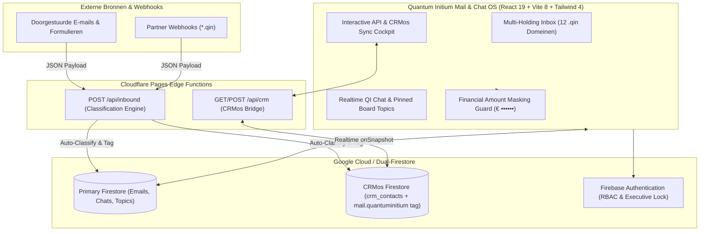

# Quantum Initium Network Mail — Multi-Holding Enterprise Mail, Realtime QI Chat & Automated CRMos Triage Hub

[](https://www.typescriptlang.org/)
[](https://react.dev/)
[](https://vitejs.dev/)
[](https://tailwindcss.com/)
[](https://firebase.google.com/)
[](https://quantum-initium-network-mail.vercel.app)

> **Executive Summary (NL):** **Quantum Initium Network Mail** (`mail.quantuminitium.com`) is de centrale, multi-tenant zakelijke communicatiehub voor alle **12 ondernemingen** binnen de **Quantum Initium Holding**. Het platform verenigt 12 gescheiden zakelijke postvakken (`*.qin`), realtime **QI Chat** met vastgezette directie-onderwerpen, **Privacy-by-Design bedragmaskering**, en een serverloze **Inbound Auto-Categorization & Bidirectionele CRMos API** die elk binnenkomend bericht automatisch classificeert en voorziet van de `mail.quantuminitium` systeemtag.
>
> **Executive Summary (EN):** **Quantum Initium Network Mail** is an enterprise multi-holding communication operating system managing 12 corporate `.qin` domains, real-time executive **QI Chat**, automatic financial amount masking (`€ ••••••`), and edge-deployed inbound email classification webhooks (`/api/inbound`, `/api/crm`) with live dual-Firestore synchronization into **CRMos**.

---

## Waarom dit project technisch onderscheidend is (For Technical Recruiters & CTOs)

Multi-holding organisaties kampen vaak met gefragmenteerde inboxen, handmatige CRM-invoer en gevoelige financiële cijfers die onbeschermd op schermen zichtbaar zijn. **Quantum Initium Network Mail** lost dit op met vier kerninnovaties:

1. **Intelligente Inbound Classificatie & Auto-Routing Engine (`functions/api/inbound.ts`, `src/services/crmosService.ts`)**:
   - Elke inkomende e-mail, webhook of formulierinzending wordt door een gewogen heuristische scorings-engine geanalyseerd op ontvanger-domein (`+50`), afzender-domein (`+25`), expliciete holding-ID (`+100`) en domeinspecifieke trefwoordclusters (`+15` per match).
   - Kent automatisch de juiste holding, afdelingscategorie (*Juridisch & Compliance*, *Financieel & Investeringen*, *Vastgoed & Dossier*, *HR & Payroll*, *Marketing & Groei*, *Directie & Bestuur*) en urgentie-status (*Hoog* bij deadlines of grote eurobedragen) toe.
2. **Dual-Firestore Architectuur & Verplichte `mail.quantuminitium` CRMos Sync**:
   - Verbindt gelijktijdig met de primaire communicatie-database én de centrale **CRMos Firestore (`crmosone-dev`)** omgeving (`src/firebase.ts`).
   - Elke afzender of geadresseerde wordt automatisch ge-upsert in CRMos met de verplichte systeemtags `mail.quantuminitium`, `mail.quantuminitium:<holding_id>` en `categorie:<categorie>`, inclusief een interactieve **API & CRMos Hub Modal (`ApiCrmHubModal.tsx`)** voor live inspectie en handmatige resync.
3. **Privacy-by-Design Financiële Bedragmaskering (`FormattedAmountText`)**:
   - Een gespecialiseerde regex-tokenizer (`AMOUNT_REGEX`) detecteert valuta- en contractbedragen (bijv. `€ 1.850.000,- k.k.`, `€ 450.000,00`, `EUR 128.500,- excl. btw`) in zowel e-mailbodies als chatberichten en vervangt deze standaard door interactieve `👁️ € ••••••` privacy-pills totdat een geautoriseerde directiegebruiker ze expliciet onthult.
4. **Unified 12-Holding Workspace + Realtime QI Chat**:
   - Naadloos schakelen tussen een geconsolideerde *Alle Ondernemingen* master-inbox en 12 individuele holding-postvakken, gecombineerd met **QI Chat** (realtime kanalen, vastgezette directiedossiers, leesbevestigingen en concept-opslag in `localStorage`).

---

## Systeemarchitectuur



---

## De 12 Ondersteunde Netwerkondernemingen

| Onderneming | Intern Domein | Standaard Categorie | Focusgebied binnen de Holding |
| :--- | :--- | :--- | :--- |
| **Quantum Initium** | `quantuminitium.qin` | Directie & Bestuur | Centrale Holding, Governance & Kerntechnologie |
| **Immigratiepunt** | `immigratiepunt.qin` | Juridisch & Compliance | IND-referentschap, Kennismigranten & Relocatie |
| **VVC (Verdienende Vrienden Club)** | `vvcclub.qin` | Financieel & Investeringen | Investeringssyndicaat, Tranches & Netwerk |
| **Investbotiq** | `investbotiq.qin` | Financieel & Investeringen | Quant Trading, Algoritmes & Vermogensbeheer |
| **WoningVry** | `woningvry.qin` | Vastgoed & Dossier | Off-Market Vastgoedportefeuille & Taxaties |
| **CRMos** | `crmos.qin` | Technisch & API | Enterprise CRM, ATS & API-infrastructuur |
| **Djobba** | `djobba.qin` | HR & Payroll | Talent Marketplace, Interim & Factoring |
| **Trusting Work** | `trustingwork.qin` | HR & Payroll | Detachering, Compliance & Urenverwerking |
| **Boostplug** | `boostplug.qin` | Marketing & Groei | B2B Leadgeneratie, Funnels & Performance ROAS |
| **Spontiva** | `spontiva.qin` | Events & Hospitality | Zakelijke Gala's, VIP Events & Lifestyle |
| **Zheavenzy** | `zheavenzy.qin` | Algemeen / Commerce | Luxury Commerce, Mobiliteit & Vlootbeheer |
| **Logs Rent** | `logsrent.qin` | Logistiek & Verhuur | Zakelijke Logistiek, Materieel & Verhuur |

---

## Edge API Endpoints (`/api/inbound` & `/api/crm`)

### 1. `POST /api/inbound` — Automatische E-mail Ingest & Categorisatie
Ontvangt een ruwe e-mail of webhook-payload, classificeert deze onder de juiste holding, slaat het bericht op in Firestore en synchroniseert de afzender direct met CRMos:

```bash
curl -X POST https://mail.quantuminitium.com/api/inbound \
  -H "Content-Type: application/json" \
  -d '{
    "fromName": "Alexander van der Vliet",
    "fromEmail": "alexander@vvcclub.qin",
    "toEmail": "info@woningvry.qin",
    "subject": "Nieuw off-market vastgoeddossier Singel Amsterdam",
    "body": "Graag beoordeling van de koopsom ad € 1.850.000,- k.k. voor Tranche A."
  }'
```
**Resultaat**: Wordt gerouteerd naar `woningvry` (*Financieel & Investeringen*), krijgt prioriteit `Hoog` (wegens bedragherkenning), en voorziet `alexander@vvcclub.qin` in CRMos van de tags `["mail.quantuminitium", "mail.quantuminitium:woningvry", "categorie:financieel-&-investeringen"]`.

### 2. `GET / POST /api/crm` — Bidirectionele CRMos Contact Synchronisatie
- `GET /api/crm`: Retourneert alle gesynchroniseerde CRMos-contacten die zijn voorzien van de `mail.quantuminitium` tag.
- `POST /api/crm`: Upsert een nieuw of bestaand zakelijk contact rechtstreeks in de centrale CRMos-database met behoud van bestaande tags en dealwaarde.

---

## Tech Stack

| Categorie | Technologieën |
| :--- | :--- |
| **Frontend Core** | React 19, TypeScript 7.0, Vite 8.3 |
| **Styling & Design** | Tailwind CSS v4 (`@tailwindcss/vite`), Lucide React Icons, Bespoke SVG/Canvas bedrijfslogo's (`CompanyLogo.tsx`, `QuantumLogo.tsx`) |
| **Backend & Edge** | Cloudflare Pages Functions (`functions/api/inbound.ts`, `functions/api/crm.ts`), Firestore REST v1 API |
| **Database & Realtime** | Dual Google Cloud Firestore instances (`cloudiaudi` + `crmosone-dev`), Firebase Authentication |
| **Asset Pipeline** | Geautomatiseerde LogoAnywhere PWA & OpenGraph asset-generator (`scripts/generate-assets.js` met `sharp`) |

---

## Lokaal Ontwikkelen & Uitvoeren

### Vereisten
- **Node.js** v20+ (of Bun) en `npm`

### Installatie & Starten
```bash
git clone https://github.com/JamalDrenthe/Quantum-Initium-Network-Mail.git
cd Quantum-Initium-Network-Mail
npm install
npm run dev
```
De ontwikkelserver start standaard op `http://localhost:3000`.

### Beschikbare Scripts
| Script | Beschrijving |
| :--- | :--- |
| `npm run dev` | Start de Vite ontwikkelserver op poort `3000`. |
| `npm run build` | Genereert de geoptimaliseerde productiebundel in `dist/`. |
| `npm run lint` | Voert een strikte TypeScript typecheck (`tsc --noEmit`) uit. |
| `npm run preview` | Serveert de productiebuild lokaal. |

---

## Over de Architect & Samenwerking

Ontworpen en gebouwd door **Jamal Drenthe** — Full-Stack Software Engineer, Enterprise Systems Architect & Founder van **Quantum Initium**.

Ben je **recruiter**, **CTO** of **zakelijke beslisser** en zoek je een ervaren bouwer voor multi-tenant bedrijfssoftware, intelligente e-mail/CRM-automatisering of realtime samenwerkingstools?

- **GitHub**: [@JamalDrenthe](https://github.com/JamalDrenthe)
- **E-mail**: [info@jamaldrenthe.com](mailto:info@jamaldrenthe.com)
- **Live Omgeving**: [quantum-initium-network-mail.vercel.app](https://quantum-initium-network-mail.vercel.app)
